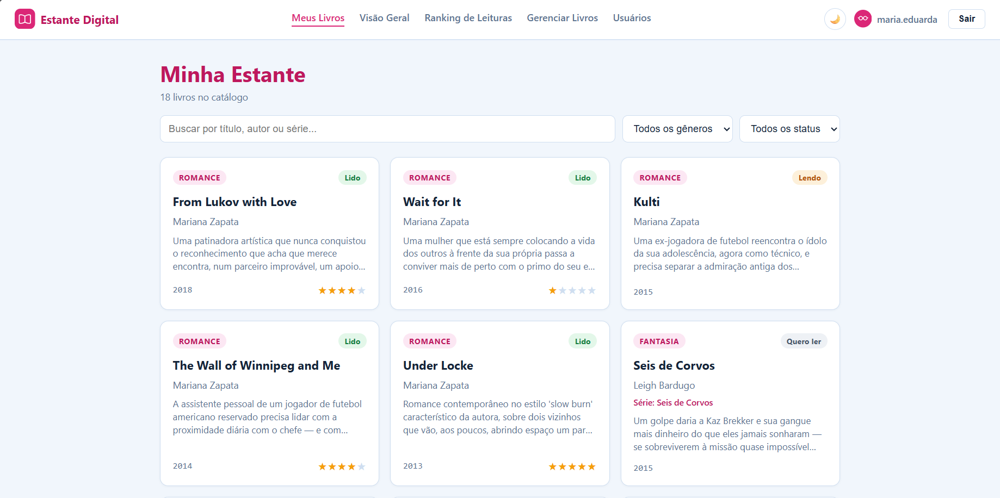
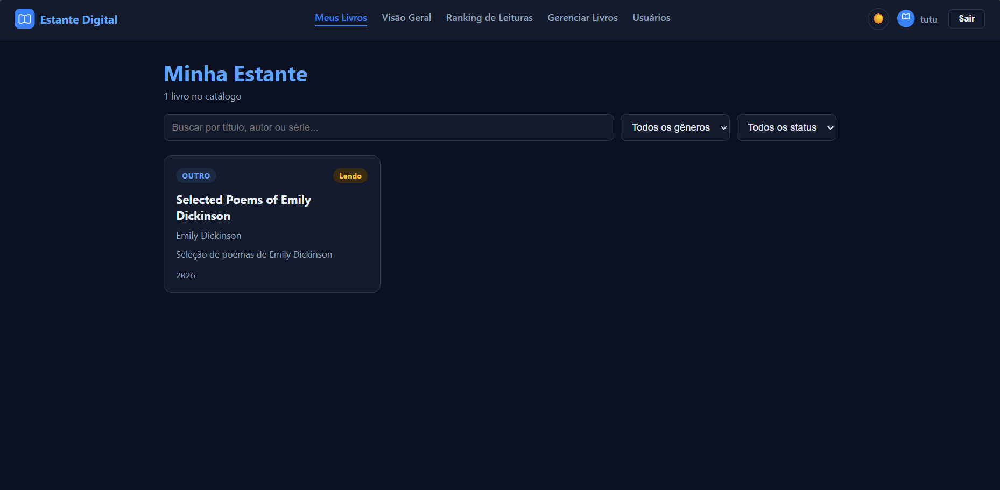
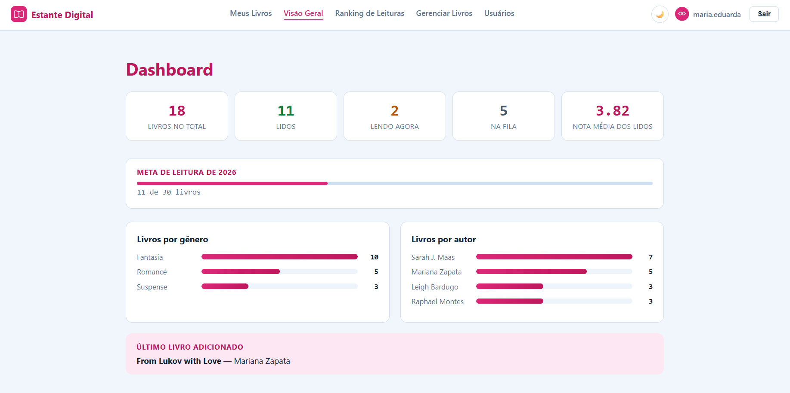
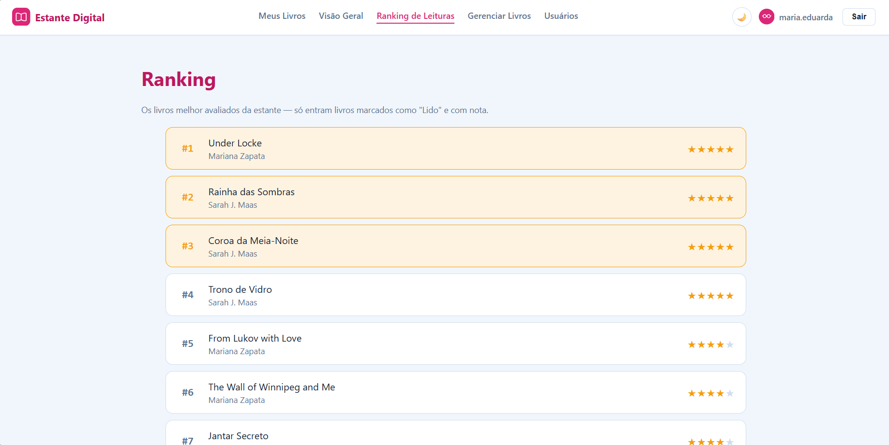
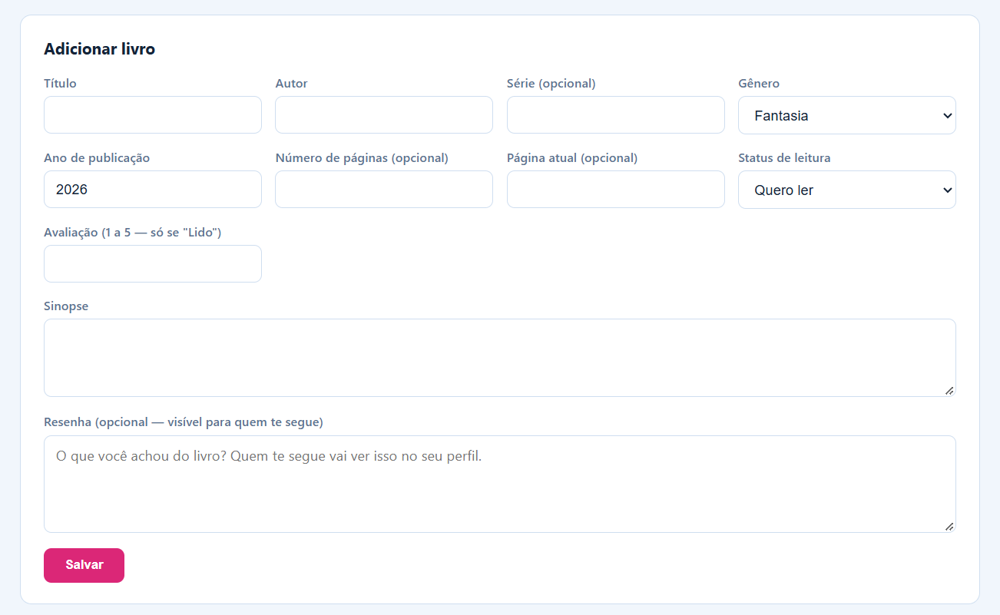
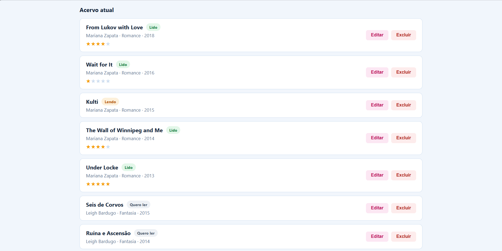
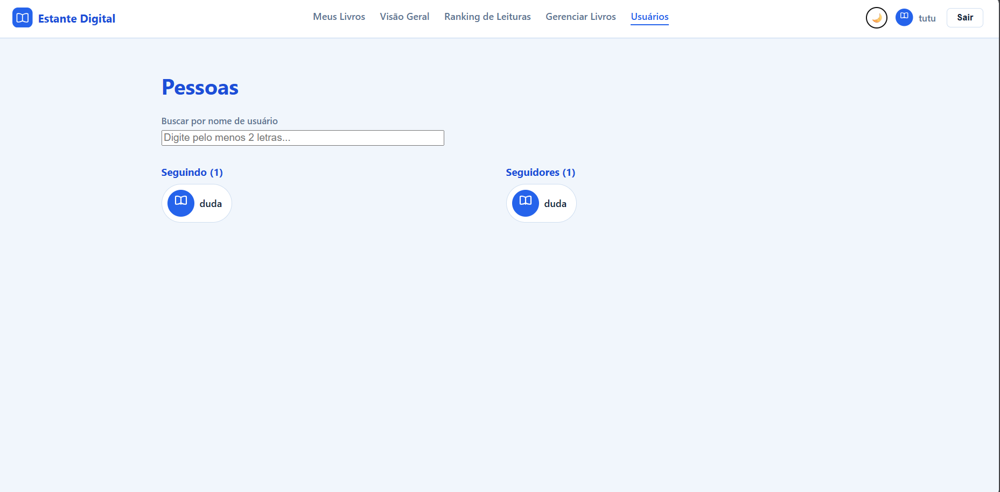
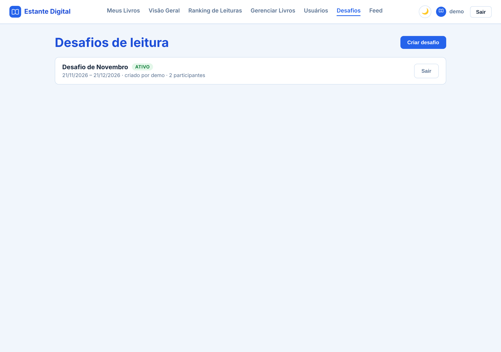
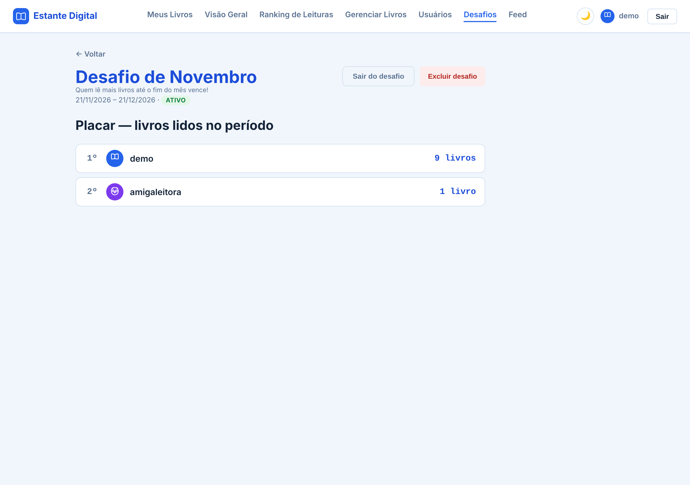
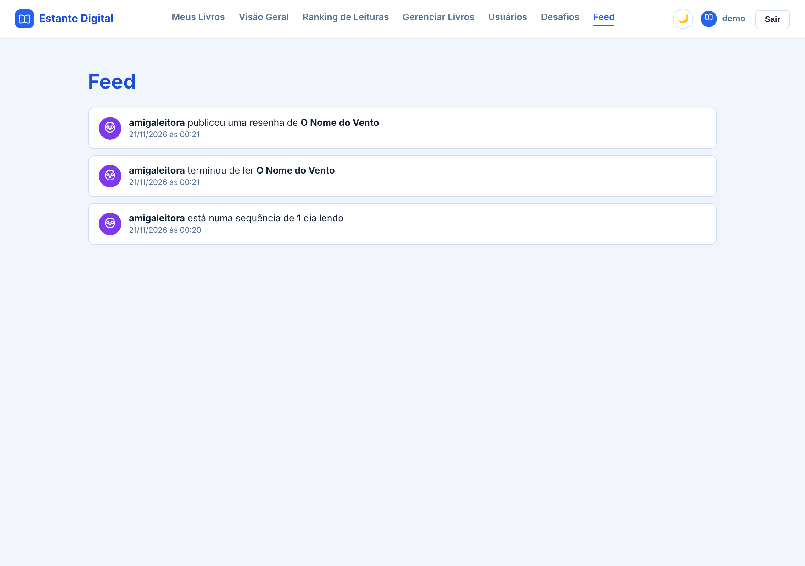

# 📚 Estante Digital

Sistema full stack de gestão de acervo literário - catálogo de livros, dashboard de leitura e área administrativa autenticada, com Clean Architecture no backend e deploy via Docker.

> Projeto final da disciplina de ASP.NET Core + React da Fatec SBC, com tema próprio: uma estante pessoal de livros.

## 🖼️ Telas

**Minha Estante** — catálogo pessoal, com busca e filtro por gênero/status (tema claro e tema escuro, cada conta com sua própria cor de destaque):

| Tema claro | Tema escuro |
|---|---|
|  |  |

**Visão Geral** e **Ranking de Leituras** — estatísticas da estante e os livros melhor avaliados:

| Dashboard | Ranking |
|---|---|
|  |  |

**Gerenciar Livros** — cadastro e edição do acervo (CRUD completo):

| Adicionar livro | Acervo atual |
|---|---|
|  |  |

**Perfil e rede social** — personalização de conta, seguir outras pessoas e estante pública:





**Desafios de leitura, streak e feed** (Fase 4) — desafios em grupo com placar, sequência de dias lendo e atividade de quem você segue:







## 📌 Descrição

A Estante Digital é um catálogo de livros com:

- **Conta própria por usuário** - cada pessoa cadastrada tem sua própria estante privada; ninguém vê ou edita os livros de outra conta.
- **Dashboard e ranking pessoais** - estatísticas (total de livros, lidos/lendo/na fila, nota média, distribuição por gênero e por autor) e um ranking dos livros melhor avaliados (inspirado nas listas do Skoob), ambos calculados sobre a estante de quem está logado.
- **Tema claro/escuro** - alternável a qualquer momento, com a preferência lembrada entre visitas.
- **Cadastro e login com senha de verdade** - hash PBKDF2 (nunca texto puro), autenticação por JWT com refresh token.
- **Perfil personalizável** - nome de usuário (gerado a partir do e-mail no cadastro, trocável depois), ícone e cor de destaque da interface, escolhidos entre opções fixas; troca de senha.
- **Resenha, progresso de leitura e meta anual** - resenha em texto por livro, página atual (com barra de progresso), e uma meta de livros lidos no ano corrente, acompanhada no dashboard.
- **Seguir outras pessoas** - busque por nome de usuário e siga outras contas para ver a estante completa delas (livros, status e resenhas); antes de seguir, só as estatísticas públicas do perfil ficam visíveis.
- **Desafios de leitura em grupo, streak e feed de atividade** - crie ou entre em desafios abertos (ex.: "quem lê mais livros até o fim do mês"), com placar sempre recalculado a partir da estante de cada participante; marque manualmente os dias em que leu para acompanhar sua sequência (streak); e veja num feed o que as contas que você segue andam fazendo (livro terminado, resenha nova, meta batida, check-in, desafio concluído) — inspirado no GymRats.

## 🛠️ Stack

- **Backend:** ASP.NET Core 8 (Minimal hosting + Controllers), autenticação JWT manual (sem pacotes externos de terceiros)
- **Frontend:** React 19 + Vite, React Router, Axios com interceptors
- **Persistência:** PostgreSQL via EF Core (produção/Docker) 
- **Infraestrutura:** Docker / Docker Compose (API + frontend + banco Postgres), Nginx (serving do build do React)

## 🧱 Arquitetura

Clean Architecture no backend, em 4 projetos:

```
src/api/
├── EstanteDigital.Domain          (entidades, enums, interfaces de repositório — sem depender de nada)
├── EstanteDigital.Application     (DTOs, serviços com as regras de negócio, interfaces de serviço)
├── EstanteDigital.Infrastructure  (JWT, hash de senha, repositórios — PostgreSQL/EF Core e JSON)
└── EstanteDigital.Api             (Controllers, Program.cs — composição de tudo)
```

Detalhes de cada camada e o porquê da divisão: [`docs/ARQUITETURA.md`](docs/ARQUITETURA.md).

## 🚀 Execução

### Opção A — Docker (recomendado para avaliar o projeto rápido)

```bash
docker compose up --build
```

- Frontend: http://localhost:8080
- API: http://localhost:5230 (health check em `/health`)
- Banco: PostgreSQL, container próprio (`db`), dados num volume Docker

### Opção B — Modo desenvolvimento (dois terminais, sem Postgres)

```bash
# Terminal 1
cd src/api/EstanteDigital.Api
dotnet run

# Terminal 2
cd src/frontend
npm install
npm run dev
```

- Frontend: http://localhost:5173
- API: http://localhost:5230 (persistência em arquivo JSON nesse modo)

### Conta de demonstração

| E-mail                        | Senha         |
|-------------------------------|---------------|
| `demo@estantedigital.com`     | `Estante@123` |

Já vem com uma estante de 19 livros cadastrados. Ou crie sua própria conta pelo link "Cadastrar" na tela de login (cada conta começa com a estante vazia).

> Projeto de portfólio/estudo (credencial de demonstração fixa no código de propósito, visível no repositório).

## 🔐 Segurança

- Senhas com hash PBKDF2-HMACSHA256 (100.000 iterações, salt aleatório por conta), nunca texto puro
- Autenticação JWT (assinatura HMAC-SHA256, implementação manual, sem `Microsoft.AspNetCore.Authentication.JwtBearer`)
- Refresh token com rotação, revogado no logout
- Toda rota de `/api/livros` e `/api/dashboard` exige `[Authorize]` e filtra pelo id de quem está logado (uma conta nunca enxerga nem edita livros de outra)
- CORS restrito às origens do próprio frontend (dev e Docker)

## 📈 Próximos passos

- Testes automatizados (xUnit no backend, Vitest no frontend)
- Migrations de verdade via `dotnet-ef` (hoje o schema do Postgres é criado com `EnsureCreated`, suficiente para este estágio do projeto)
- CI/CD completo (o workflow atual em `.github/workflows/ci.yml` só valida o build, não faz deploy)
- Observabilidade (OpenTelemetry) e deploy em nuvem (Azure/AWS)

## 📖 Sobre o catálogo inicial

Os livros e autores do catálogo de demonstração são reais (títulos, séries e anos conferidos); as sinopses são redações originais sobre a premissa pública de cada livro. Status de leitura e notas são dados fictícios, só para dar conteúdo ao dashboard; edite à vontade pela área administrativa depois de logar :)
